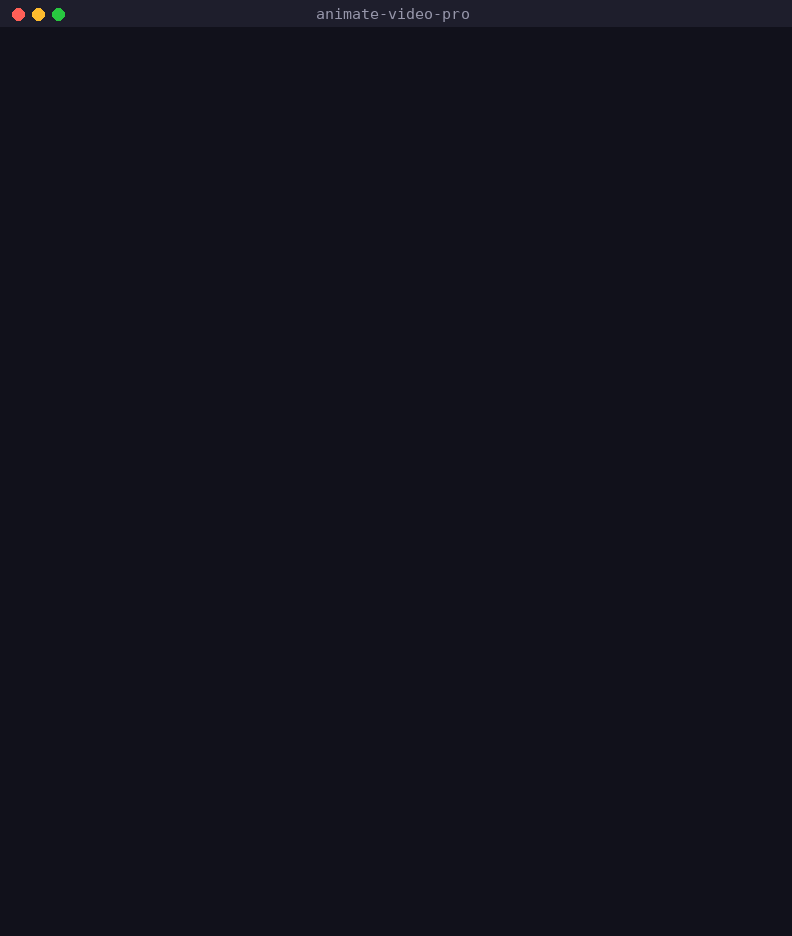

<p align="center"></p>

<h1 align="center">Animate Video Pro</h1>
<p align="center">por @joao_lopes</p>
<p align="center"><b>Mande um áudio. Receba um vídeo animado, sincronizado e com a cara da sua marca.</b><br>
Uma skill aberta (SKILL.md) que funciona no Claude Code, Codex, Antigravity, Gemini CLI, Cursor, OpenCode, Copilot e outros.</p>

---

## Instalar

**Com Node 20+ (qualquer sistema):**

```bash
npx @joao_lopes/animate install
```

Direto do GitHub, sem passar pelo npm:

```bash
npx -y github:UnnicaATM1/animate-video-pro install
```

> **Rode num terminal de verdade** (PowerShell, Windows Terminal, Terminal do macOS).
> Dentro do chat do Codex, Claude Code ou Antigravity não aparece o painel, porque o agente
> executa comandos sem terminal interativo. Nesse caso use o modo direto:
>
> ```bash
> npx -y github:UnnicaATM1/animate-video-pro install --yes --harness=claude-code,codex --formats=9:16
> ```

**macOS / Linux:**

```bash
curl -fsSL https://raw.githubusercontent.com/UnnicaATM1/animate-video-pro/main/install.sh | sh
```

**Windows (PowerShell):**

```powershell
irm https://raw.githubusercontent.com/UnnicaATM1/animate-video-pro/main/install.ps1 | iex
```

O instalador abre com a animação do logo e pergunta:

1. **Em quais agentes instalar.** Ele detecta os que você já tem e deixa marcados. Dá para escolher vários.
2. **Onde instalar:** global (todos os projetos) ou só no projeto atual.
3. **Quais formatos de vídeo você usa.** Pode marcar mais de um.
4. **Qual formato é o padrão**, quando você não disser nada.
5. Taxa de quadros, motor de renderização (Remotion, Hyperframes ou automático) e pacote de módulos.

As respostas ficam em `animate.config.json`, dentro da pasta da skill, e o agente lê esse arquivo antes de cada vídeo.

## Onde a skill é instalada

| Agente | Global | Só no projeto |
|---|---|---|
| Claude Code | `~/.claude/skills/` | `.claude/skills/` |
| OpenAI Codex | `~/.codex/skills/` | `.agents/skills/` |
| Google Antigravity | `~/.gemini/config/skills/` e `~/.gemini/antigravity-cli/skills/` | `.agents/skills/` |
| Gemini CLI | `~/.gemini/skills/` | `.gemini/skills/` |
| Cursor | `~/.cursor/skills/` | `.cursor/skills/` |
| OpenCode | `~/.config/opencode/skills/` | `.opencode/skills/` |
| GitHub Copilot | `~/.copilot/skills/` | `.github/skills/` |
| Universal (Amp, Cline, Droid, Pi…) | `~/.agents/skills/` | `.agents/skills/` |

Os caminhos ficam todos em [`src/harnesses.js`](src/harnesses.js). Para adicionar um agente novo, basta acrescentar uma entrada nesse arquivo.

## Formatos

| Proporção | Tamanho | Uso típico |
|---|---|---|
| 9:16 | 1080×1920 | Reels, Shorts, TikTok, Status |
| 1:1 | 1080×1080 | Feed, LinkedIn |
| 4:5 | 1080×1350 | Feed do Instagram |
| 3:4 | 1080×1440 | Feed novo do Instagram |
| 16:9 | 1920×1080 | YouTube, site |
| 4:3 | 1440×1080 | Telas clássicas |

Peça "nos meus formatos" e o agente renderiza uma versão para cada formato escolhido, refazendo o layout de cada proporção.

## Comandos

```bash
npx @joao_lopes/animate install    # instalação interativa
npx @joao_lopes/animate doctor     # confere Node, Python, FFmpeg e GPU
npx @joao_lopes/animate list       # mostra onde está instalado
npx @joao_lopes/animate uninstall  # remove o que o instalador criou
```

Modo direto, sem perguntas (bom para CI ou script):

```bash
npx @joao_lopes/animate install --yes \
  --harness=claude-code,codex,antigravity \
  --formats=9:16,16:9,1:1 --primary=9:16 \
  --fps=30 --renderer=auto --modules=visual
```

Outras opções: `--scope=project`, `--overwrite=backup|replace|skip`, `--dry-run`, `--no-anim`. A animação é pulada sozinha quando o terminal não é interativo ou quando `NO_COLOR` está definido.

## Pacotes de módulos

| Pacote | O que entra |
|---|---|
| Essencial | WhisperX, FFmpeg, renderizador |
| Visual | + YuNet (rosto), MediaPipe (mãos/corpo), BEN2 (recorte de pessoa), Depth Anything (parallax) |
| Completo | + SAM 2 (recorte de objeto), Demucs (separar voz), PySceneDetect (cortes), CLAP (efeitos sonoros) |

Os módulos não são baixados na instalação. O agente instala cada um só quando um vídeo precisar dele, num ambiente isolado.

## Para quem mantém o repositório

```bash
npm install
npm run import-core -- /caminho/para/narrate-to-animation   # traz scripts/, references/ e assets/
npm test                                                    # instala em um HOME temporário e confere tudo
```

O `import-core` deixa de fora arquivos com nome de marca de cliente. Mesmo assim, revise `references/` antes de publicar.

## Licença

MIT. Os modelos e ferramentas de terceiros têm licenças próprias (Remotion, checkpoints maiores do Depth Anything etc.). Confira antes de usar em trabalho comercial.
